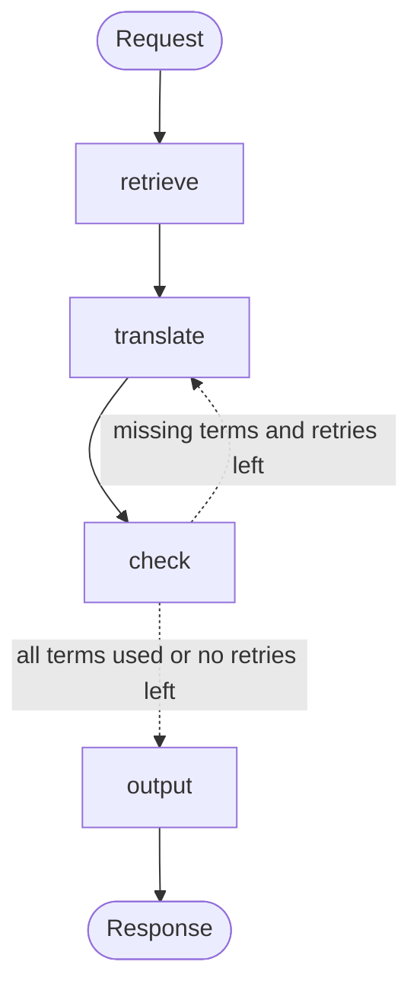

# Term-Aware Translation API

An English to Chinese translation API. It finds glossary terms in the input, tells a local LLM which translations to use, checks the output, and asks the model to fix any missing terms.

## Why

General machine translation often ignores company terminology. For example, a glossary may say "power button" must be "开关键", but a model may write "电源按钮". This project adds the glossary to the prompt and checks the result, so the output follows the glossary.

## How it works



1. **Retrieve.** The API looks for glossary terms in two ways.
   - Exact match with spaCy. It matches lowercase forms and lemmas, so "power buttons" also finds "power button". When terms overlap, the longest match wins. These terms are **must-use** terms.
   - Vector search with multilingual-e5-small embeddings in Qdrant. These terms are **reference** terms. The model may use them if they fit.
2. **Translate.** A local Qwen2.5 model (via Ollama) translates the text. The prompt lists the must-use terms and the reference terms.
3. **Check.** The API checks whether each must-use translation appears in the output. The check ignores spaces but keeps letter case.
4. **Retry.** If terms are missing, the model gets its last translation and the missing terms, and tries again. It retries at most 2 times.
5. **Output.** The API returns the translation, the terms, the adherence rate, the number of retries, and any terms that are still missing.

Steps 2 to 5 run as a LangGraph workflow.

## Tech stack

| Part | Tool |
|---|---|
| API | FastAPI, Pydantic |
| Exact match | spaCy PhraseMatcher |
| Embeddings | intfloat/multilingual-e5-small |
| Vector database | Qdrant |
| LLM | Qwen2.5 via Ollama |
| Workflow | LangGraph |
| Packaging | Docker, Docker Compose |

## Quick start

### Requirements

- Python 3.11
- Docker
- Ollama

### 1. Set up the project

```bash
git clone https://github.com/DawnishL/term-aware-translation-api.git
cd term-aware-translation-api
python3.11 -m venv .venv
source .venv/bin/activate
pip install -r requirements.txt
python -m spacy download en_core_web_sm
```

### 2. Add your settings and glossary

```bash
cp .env.example .env
cp data/glossary.example.csv data/glossary.csv
```

Open `.env` and set your own `API_KEY`.

The glossary is a CSV file with two columns, `source` (English) and `target` (Chinese). The example file has 10 terms. Replace it with your own glossary.

### 3. Start Qdrant and the model

```bash
docker compose up -d qdrant
ollama pull qwen2.5:7b
```

### 4. Run the API

```bash
python -m uvicorn app.main:app --port 8001
```

Open http://localhost:8001/docs to try the API in your browser.

### Run with Docker

You can also run the API and Qdrant together in Docker. Ollama still runs on your computer.

```bash
docker compose up -d --build
```

The glossary is copied into the image when it is built. If you change `data/glossary.csv`, build the image again.

## Usage

All endpoints except `/health` need an API key in the `X-API-Key` header.

### Translate

```bash
curl -X POST http://localhost:8001/translate \
  -H "Content-Type: application/json" \
  -H "X-API-Key: your-key" \
  -d '{"text": "Press and hold the power button to restart the control hub.", "top_k": 3}'
```

Response

```json
{
  "query": "Press and hold the power button to restart the control hub.",
  "translation": "长按开关键以重启多功能网关。",
  "must_use": [
    {"source": "power button", "target": "开关键", "match_type": "exact", "score": null},
    {"source": "control hub", "target": "多功能网关", "match_type": "exact", "score": null}
  ],
  "reference": [
    {"source": "restore factory settings", "target": "恢复出厂设置", "match_type": "vector", "score": 0.852},
    {"source": "control panel", "target": "控制面板", "match_type": "vector", "score": 0.849},
    {"source": "reset", "target": "复位", "match_type": "vector", "score": 0.843}
  ],
  "adherence": 1.0,
  "retries": 0,
  "missing": []
}
```

| Field | Meaning |
|---|---|
| `must_use` | Terms found by exact match. The model must use them. |
| `reference` | Terms found by vector search. The model may use them. |
| `adherence` | Share of must-use terms that appear in the translation, from 0 to 1. |
| `retries` | How many times the model translated again. 0 means the first try used all terms. |
| `missing` | Must-use terms that are still missing in the final translation. |

### Search only

`POST /search` takes the same request body and returns only `must_use` and `reference`, without translation.

### Request fields

| Field | Type | Rule |
|---|---|---|
| `text` | string | Required. 1 to 2000 characters. |
| `top_k` | integer | Optional. Number of reference terms, 1 to 20. Default is 5. |

### Errors

| Status | When |
|---|---|
| 401 | The API key is missing or wrong. |
| 422 | The request body does not follow the rules above. |

## Evaluation

I tested the retry step with two small, hand-written test sets. Each sentence was translated twice, once without retries and once with up to 2 retries. Temperature was 0. The results use my private glossary of about 200 terms, so results with the example glossary will be different.

- **Short sentences.** 16 sentences, 1 or 2 must-use terms each, 21 terms in total.
- **Long sentences.** 12 sentences, 3 to 6 must-use terms each, 53 terms in total.

Adherence is counted per term (terms used ÷ all must-use terms).

| Model | Test set | Before retry | After retry | Sentences with all terms (before → after) |
|---|---|---|---|---|
| Qwen2.5 7B | Short | 100% | 100% | 16 → 16 |
| Qwen2.5 7B | Long | 98.1% | 100% | 11 → 12 |
| Qwen2.5 1.5B | Short | 81.0% | 90.5% | 12 → 14 |
| Qwen2.5 1.5B | Long | 88.7% | 90.6% | 7 → 8 |

### What I found

- **The prompt does most of the work.** With must-use terms in the prompt, the 7B model missed only 1 of 74 terms on the first try.
- **Retries help small models more.** The 1.5B model gained 9.5 points on short sentences.
- **Small models often ignore the feedback.** In several cases the 1.5B model returned the same translation after 2 retries.
- **Retries can hurt quality.** To pass the check, models sometimes repeated content or put a term in a wrong place. In one case the meaning of the sentence was wrong, but the check passed.

To run the evaluation yourself

```bash
python -m scripts.evaluate
python -m scripts.evaluate data/test_sentences_hard.txt
OLLAMA_MODEL=qwen2.5:1.5b python -m scripts.evaluate
```

## Limitations

- **The check only looks for strings.** A short term can be found inside a longer word. For example, "电源" (power supply) is found inside "电源适配器" (power adapter).
- **The check does not judge quality.** A translation can use every term and still be wrong or unnatural. A real system would need human review or a separate quality check.
- **The test sets are small** and were written to include many glossary terms.
- **Some glossary targets only fit certain contexts.** For example, "充电完成" (fully charged) works as a status message but is less natural inside a longer sentence.

## Project structure

```text
app/
  main.py            FastAPI app and endpoints
  config.py          Settings from .env
  auth.py            API key check
  schemas.py         Request and response models
  llm.py             Ollama client
  prompts.py         Prompt templates
  checking.py        Term check and adherence rate
  translation.py     Translation service
  retrieval/         Glossary loading, exact match, embeddings, Qdrant
  graph/             LangGraph state, nodes, and workflow
scripts/
  evaluate.py        Evaluation script
  search_cli.py      Command line search tool
data/
  glossary.example.csv
  test_sentences.txt
  test_sentences_hard.txt
```